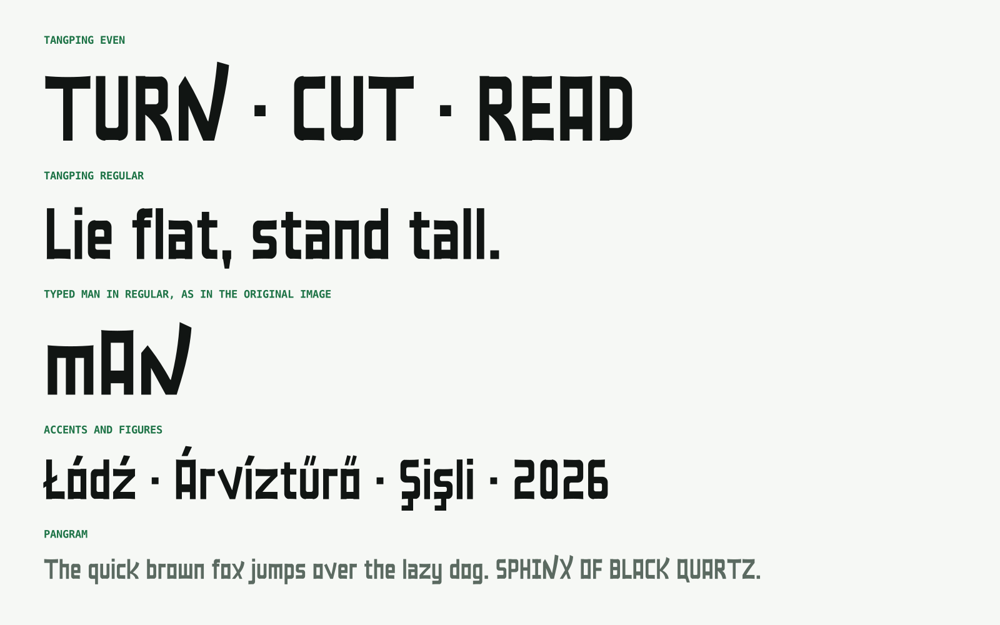
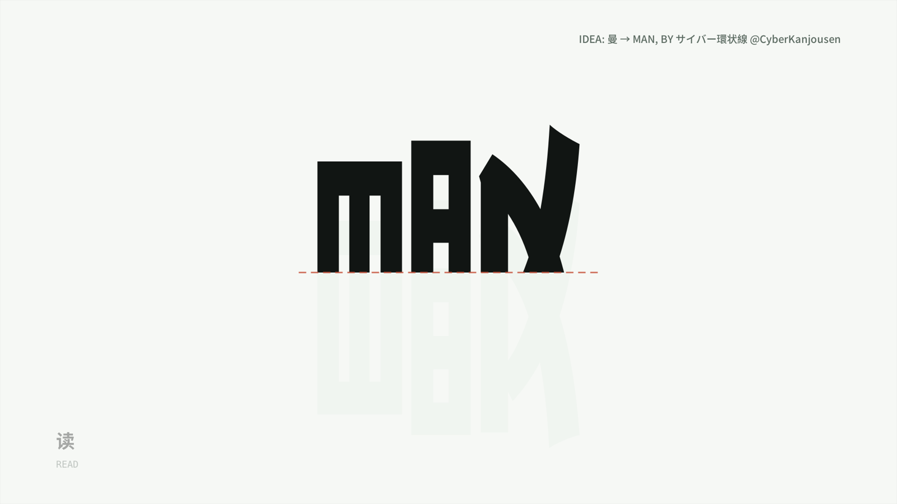
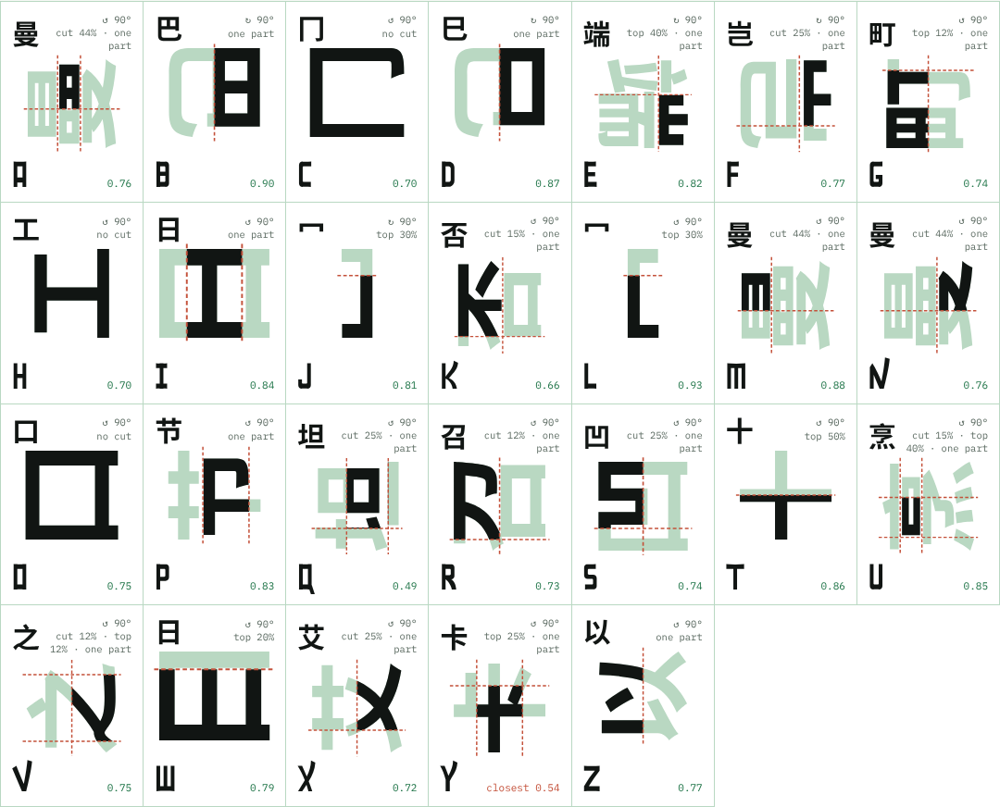
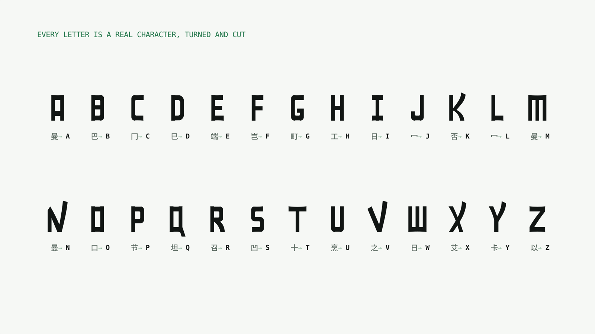

# Tangping 躺平体

**A display typeface where every Latin letter is a bold Hei hanzi lying on its side.**

Turn 曼 a quarter-turn, slice it straight across, and its three parts read **M A N**. Tangping draws the whole Latin alphabet on that rule, and every letter has a real Chinese character it comes from.

> **Idea by サイバー環状線 ([@CyberKanjousen](https://x.com/CyberKanjousen))**, who posted on 21 October 2026:
> 「以防你不知道：曼 从中间劈开就是 MAN！」 *(In case you didn't know: split 曼 down the middle and it's MAN!)*
> Tangping grows that one observation into a full typeface. See [Credits](#credits).



<p>
  <a href="docs/media/tangping-motion.mp4">▶ Watch the 27-second motion piece</a> (with original music) ·
  <a href="https://reny1cao.github.io/tangping/">Try it: type tester and source map</a> ·
  <a href="https://github.com/reny1cao/tangping/releases/latest">Download the fonts</a>
</p>

## The idea



Lay 曼 down counter-clockwise and cut off a little under half of it. 日 becomes **M**, 罒 becomes **A**, and 又 becomes **N**, with the 捺 stroke still sweeping past the top. The M, A and N in this font are traced from that move; everything else follows the rules it reveals:

- **Thick bars, thin stems.** Bars are Hei vertical strokes turned flat (135 units). Stems are Hei horizontals stood upright (100 units).
- **Cut at the baseline.** Every stem ends in a straight slice, where the character was cut.
- **撇 falls, 捺 rises.** Strokes falling to the right taper like 撇. Strokes rising to the right sweep past the top like 捺 and end in an angled tip.
- **Curves bend like Hei turns.** Where a Latin letter is round, its corners bend the way 九, 己 and 乚 bend in a bold Hei font. Square letters keep square corners, and O stays a square 口.
- **Condensed, with two heights.** Two-stem letters are 340 units wide. Capitals stand 689; lowercase stands 527, as M and N do in the original, with ascenders and descenders.

## Every letter has a source



We searched all 6,763 GB2312 characters in a bold Hei font, turning each a quarter-turn both ways and cutting straight across (at most half), then scored every piece against the Tangping letter. E is the 山 inside 端, R takes the curved leg of 召's 刀, T is as wide as half of 十.

| | | | | | | | | | | | | |
|---|---|---|---|---|---|---|---|---|---|---|---|---|
| A 曼 | B 巴 | C 冂 | D 巳 | E 端 | F 岂 | G 町 | H 工 | I 日 | J 冖 | K 否 | L 冖 | M 曼 |
| N 曼 | O 口 | P 节 | Q 坦* | R 召 | S 凹 | T 十 | U 烹 | V 之 | W 日 | X 艾 | Y 卡* | Z 以 |

\* No character gives a clean Q or Y; 坦 and 卡 are the closest. The search tools and results are in [`research/`](research/).



## Styles

| Style | Capitals | Lowercase |
|---|---|---|
| **Tangping Regular** | M N V W X Y Z sit short next to another capital, as in the original MAN, and stand tall elsewhere | short, with ascenders and descenders |
| **Tangping Even** | every capital is tall | short, with ascenders and descenders |

Lowercase is drawn in the capitals' stroke weights and stands on the short height, the height of M and N in the original, so **case controls the bounce**. Typing **MAN** in Tangping Regular reproduces the original image. The `ss01` stylistic set swaps the tall and short forms of M N V W X Y Z in either style.

**Character set:** the full Google Fonts *Latin Core* set (319 characters): Western, Central and Eastern European, Turkish, Baltic, Romanian, Hungarian and Esperanto, plus ẞ Ł Ħ Ŧ, ordinals, punctuation, € £ ¥ ¢, © ® ™, arrows and 「 」. 380 glyphs in all.

**OpenType:** class kerning (`kern`), accents positioned on any letter (`mark`, `mkmk`), dotless i and j under accents (`ccmp`), short capitals only inside all-caps in Regular (`calt`), tall/short capitals (`ss01`). Figures are tabular. The fonts are hinted.

## Use

**Desktop:** install `fonts/otf/Tangping-Regular.otf` and/or `fonts/otf/Tangping-Even.otf`.

**Web:** copy `fonts/webfonts/` next to your CSS and use:

```css
@import url("webfonts/tangping.css");

h1 { font-family: "Tangping", "Noto Sans SC", sans-serif; }        /* Regular */
h2 { font-family: "Tangping Even", "Noto Sans SC", sans-serif; }   /* Even */
```

Tangping is a display face: use it large, for headlines, logos, posters and titles. It covers Latin only; Chinese text falls back to the next font in your stack.

## Build from source

The fonts are generated from code. Every glyph is assembled from a few stroke primitives (stems, flared bars, 撇, 捺 and Hei turns) in [`sources/build.py`](sources/build.py), which also sets each letter's spacing from its shape, generates the kerning and accents, and hints the result with AFDKO's `otfautohint`. [`scripts/audit.py`](scripts/audit.py) measures spacing, collisions, stroke weights, colour and confusable glyphs.

```sh
python3 -m pip install -r requirements.txt
make            # fonts (spaced, kerned and hinted) → fonts/otf + fonts/webfonts, then the docs page
make check      # OTS sanitizer + Font Bakery (universal profile)
```

The motion piece and README images are rendered from the same fonts: `python3 -m pip install -r requirements-media.txt`, then `make media` (also needs `ffmpeg`, the cairo library and Noto Sans CJK).

The music is original and generated in code by [`scripts/bgm.py`](scripts/bgm.py): 96 BPM lo-fi in D minor pentatonic, with guzheng-style plucks over electric piano, pad, bass and soft drums. Picture and music share one timeline, so the blade sound lands on the cut, the beat drops as the cut-off piece falls, each letter gets its own pluck panned to its position, and every typed character clicks.

| Path | What it is |
|---|---|
| `fonts/` | Release fonts (OTF, WOFF2) and a ready-made `@font-face` CSS |
| `sources/build.py` | The font, as code |
| `research/` | Tools that find, verify and export each letter's source character |
| `scripts/` | Docs page builder, release checks, motion video and music renderer, README images |
| `docs/` | Type tester and source map (`index.html`), images, motion piece and its soundtrack |

## License

- **Fonts:** [SIL Open Font License 1.1](OFL.txt). You can use, modify and redistribute them, including commercially, as long as the fonts themselves are not sold on their own. There is no Reserved Font Name.
- **Code** (`sources/`, `research/`, `scripts/`): [MIT](LICENSE-CODE.txt).
- **Motion piece and music** (`docs/media/`): [CC BY 4.0](https://creativecommons.org/licenses/by/4.0/). Credit "Tangping by The Tangping Project Authors".
- The source map and motion piece draw Noto Sans CJK outlines (SIL OFL 1.1) to show where each letter comes from. No Noto outlines are included in the Tangping fonts.

## Credits

**Original idea:** サイバー環状線 ([@CyberKanjousen](https://x.com/CyberKanjousen) on X). Their 21 October 2026 post showed 曼 turned on its side and split into **MAN**, with the illustration signed *made by X@CyberKanjousen*. Everything here starts from that post. Go and follow them.

**Typeface, tools and motion piece:** Rocco, with Claude (Anthropic). See [AUTHORS.txt](AUTHORS.txt), [CONTRIBUTORS.txt](CONTRIBUTORS.txt), [FONTLOG.txt](FONTLOG.txt) and [CREDITS.md](CREDITS.md).

Tangping's outlines are new drawings built from stroke rules; the original illustration is not included in this repository and is not redistributed. If you share Tangping, please credit the idea to @CyberKanjousen too.

---

### 中文简介

**创意来自 サイバー環状線（[@CyberKanjousen](https://x.com/CyberKanjousen))** 2026 年 10 月 21 日的帖子：「以防你不知道：曼 从中间劈开就是 MAN！」本项目把这个发现扩展成了一整套字体。

躺平体是一款拉丁字母展示字体：每个字母都是一个"躺平"的黑体汉字。把「曼」逆时针转 90°、再横切掉将近一半，日、罒、又就分别成了 M、A、N。整套字母都按这个规则绘制：横粗竖细、底部平切、撇捺带锋，圆的地方用黑体的转折（九、己、乚）来弯；小写字母与大写同样粗细，站在"矮"的高度上，带上伸和下伸部分。每个字母都找到了真实的来源汉字（十→T、端里的山→E、凹→S、召→R……）。

字体采用 SIL 开源字体许可证 1.1，可免费商用、修改和再分发；构建与研究代码采用 MIT 许可证。分享时请一并注明创意来源 @CyberKanjousen。
